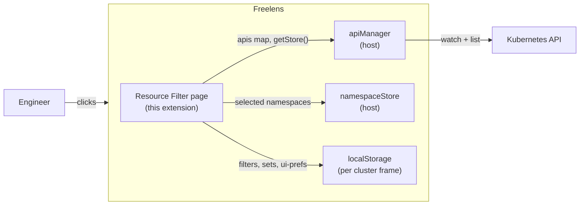
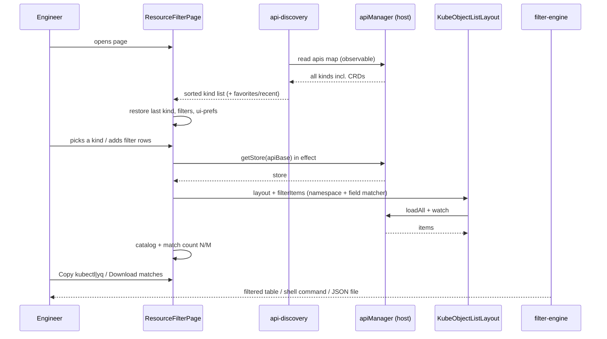

# Architecture — freelens-resource-filter-extension

## Components

- `src/renderer/index.tsx` — registers one cluster page (`resource-filter`) and its sidebar menu entry (`orderNumber: 15`, below "Cluster"). The page renders inside an `ErrorBoundary`.
- `src/renderer/components/resource-filter-page.tsx` — kind picker (favorites ★ / recent ↻), FilterBar wiring, namespace-scoped match counts, `KubeObjectListLayout`, and object-peek drawer (click a row name).
- `src/renderer/components/filter-bar.tsx` — query bar, filter rows (AND/OR), field path combobox, native operator `<select>`, output-field chips, table-column pins, yq/jq dialect, copy command, download matches, collapsible live command (`
`), saved sets.
- `src/renderer/components/error-boundary.tsx` — catches render crashes so the cluster frame stays usable.
- `src/renderer/filtering/filter-store.ts` — MobX rows + `revision` / `matchSignature` so preview and `N / M` update on remove and AND/OR toggles. Uses `makeObservable`, no decorators.
- `src/renderer/filtering/filter-engine.ts` — pure path resolution and operators (`=`, `!=`, `contains`, `!contains`, `regex`, `in`, `exists`, `!exists`, `older_than`, `newer_than`). Consecutive `or` rows form a group; groups are ANDed.
- `src/renderer/filtering/field-paths.ts` — walks a sample of loaded items (cap 200) into a field catalog + value suggestions; derives default table columns when the user has not pinned any.
- `src/renderer/filtering/field-path-search.ts` — multi-word / ranked matching for the custom field combobox (Freelens Select hardcodes substring filter).
- `src/renderer/filtering/filter-query.ts` — parse/serialize the one-line query bar.
- `src/renderer/filtering/kubectl-yq.ts` — builds `kubectl | yq` (mikefarah v4, `-o yaml`) or `kubectl | jq` (`-o json`; jq cannot parse YAML).
- `src/renderer/filtering/namespace-scope.ts` — applies the Freelens namespace picker to in-memory items (download, counts, list filter).
- `src/renderer/filtering/filter-storage.ts` — best-effort localStorage: active filters and sets per kind, per-kind session (output fields / columns / dialect), last kind, and `frf:v1:ui-prefs` (favorites, recent, preview open).
- `src/renderer/filtering/download-matches.ts` — projects downloaded JSON to selected output fields.
- `src/renderer/discovery/api-discovery.ts` — enumerates kinds from `Renderer.K8sApi.apiManager`.
- `src/main/index.ts` — empty stub (no main-process features).
- `electron.vite.config.js` + `build/global-externals.js` — renderer entry under the `preload` key; CommonJS + `preserveModules`.

## System context

## Key invariants

- Built-in resource pages are never modified. Freelens exposes no hook to inject filters into built-in lists.
- Host modules stay external (`@freelensapp/extensions`, `react`, `react-dom`, `mobx`, `mobx-react`, `react-router-dom`) via `build/global-externals.js`.
- Output stays CommonJS with `preserveModules` (`out/main/index.js`, `out/renderer/index.js`).
- Source compiles under tsc, oxc, and esbuild — no MobX decorators; use `makeObservable` maps.
- `apiManager.getStore(apiBase)` lazily creates CRD stores — call only from an effect, never during render.
- Field catalog comes from live items (sample of 200). Empty items ⇒ empty field dropdown. Rebuild skips when item fingerprints are unchanged.
- Filter rows: empty field/value disables a row (`exists` / `!exists` ignore value). Stale fields (absent from catalog) are marked and skipped.
- Combinators: default AND between rows; toggle OR on a row to join it with the previous into an OR-group; groups are ANDed.
- Namespace scope: Freelens namespace picker drives kubectl `-n` / `-A`, match counts, download, and list filtering (`namespace-scope.ts`).
- Filtering / export code must stay kind-agnostic — no hard-coded CRD or product names in logic or examples.
- Persistence is best-effort. Filters/sets use cluster-frame localStorage (`frf:v1:*`). Favorites / recent / preview-open use Freelens `ExtensionStore` (`resource-filter-ui-prefs`) with localStorage merge backup — localStorage alone can lose the last write on force-quit.

## Primary flow

